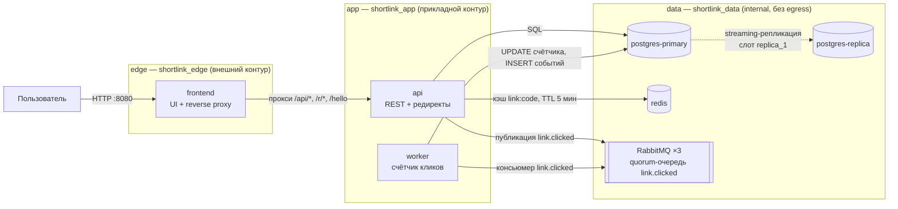

# shortlink

Учебный проект курса «Безопасность высоконагруженных систем» (НИУ ВШЭ): микросервисный сокращатель ссылок на Go 1.27. Проект демонстрирует защиту на уровне сети — контурную сегментацию Docker-сетей с политикой «запрещено всё, что не разрешено», — и отказоустойчивость: репликацию PostgreSQL, кластер RabbitMQ и проверяемое восстановление из бэкапа. Все отказы воспроизводятся демо-скриптами на одном хосте.

## Архитектура

Три Go-сервиса собираются из одного Dockerfile (build-arg `SERVICE`) и живут в трёх изолированных сетях: `edge` (внешний контур), `app` (прикладной), `data` (контур данных, без выхода в интернет).



Поток клика: пользователь переходит по `/r/{code}` → api отдаёт 302 (URL из Redis или PostgreSQL, заголовок `X-Cache` показывает источник) и публикует событие `link.clicked` в RabbitMQ → worker инкрементирует счётчик в `links` и пишет журнал `link_events`.

## Компоненты

| Сервис | Назначение | Технология |
|---|---|---|
| frontend | Единственная точка входа (порт 8080): отдаёт встроенный UI и проксирует `/api/*`, `/r/*`, `/hello` на api | Go 1.27, `embed`, `httputil.ReverseProxy` |
| api | REST: создание/список/изменение/удаление ссылок, 302-редирект с кэшем, публикация кликов; `GET /healthz` проверяет postgres+redis+rabbitmq (503 при отказе) | Go 1.27, `net/http` |
| worker | Консьюмер очереди `link.clicked`: инкрементирует счётчик кликов и пишет журнал событий | Go 1.27, amqp |
| postgres-primary | Основная БД: таблицы `links`, `link_events`; источник репликации | PostgreSQL 17 |
| postgres-replica | Горячий standby, базовая копия через `pg_basebackup`, слот `replica_1`, роль `replicator` | PostgreSQL 17 |
| redis | Кэш редиректов: ключи `link:<code>`, TTL 5 минут, инвалидация при update/delete | Redis 7 |
| rabbitmq1–3 | Кластер из 3 узлов (peer discovery `classic_config`, `pause_minority`), quorum-очередь `link.clicked` | RabbitMQ 4.1 |

## Сетевая сегментация и правила (этап 4)

Сети: `shortlink_edge`, `shortlink_app`, `shortlink_data` (последняя — `internal: true`, без выхода в интернет). Наружу опубликованы только два порта: **8080** (frontend) и **15672** (management UI rabbitmq1 — для демонстрации состояния кластера). Действует политика по умолчанию deny: разрешены только связи ниже, всё остальное невозможно из-за отсутствия общей сети.

| Откуда | Куда | Порт | Сеть |
|---|---|---|---|
| Пользователь | frontend | 8080 | published |
| frontend | api | 8080 | app |
| api | postgres-primary, postgres-replica | 5432 | data |
| api | redis | 6379 | data |
| api | rabbitmq1, rabbitmq2, rabbitmq3 | 5672 | data |
| worker | postgres-primary, postgres-replica | 5432 | data |
| worker | rabbitmq1, rabbitmq2, rabbitmq3 | 5672 | data |
| postgres-primary | postgres-replica (replication) | 5432 | data |
| Оператор | rabbitmq1 (management UI) | 15672 | mgmt (отдельный сегмент оператора `shortlink_mgmt`) |

Что явно запрещено и почему работает:

- frontend не состоит в сети `data` — из интернет-контура нельзя достучаться до БД, кэша и брокера;
- api и worker не опубликованы наружу — извне доступен только frontend;
- `data` — internal-сеть без egress: контур данных не ходит в интернет;
- репликация PostgreSQL разрешена только роли `replicator` (hba-файл `deploy/pg/hba_primary.conf`).

Как это демонстрируется:

- `demo/netcheck.sh` — прогоняет матрицу через `docker run --network shortlink_... busybox nc`: разрешённые пути соединяются, запрещённые — нет;
- `demo/break_legit_rule.sh` — отключает api от сети `data`: `/healthz` сразу отдаёт 503, создание ссылок падает, после возврата сети всё восстанавливается. Доказывает, что сервисы действительно ходят только по объявленным путям.

## Быстрый старт

Предусловия: Docker с docker compose plugin; Go 1.27 — опционально, только для `make test`.

```bash
docker compose up -d --build   # или: make up
```

После старта (реплика разворачивается через `pg_basebackup`, первый запуск занимает около минуты):

```bash
# 1. API жив:
curl localhost:8080/hello
# hello from shortlink api

# 2. Создать ссылку:
curl -X POST localhost:8080/api/links -d '{"url":"https://hse.ru"}'
# {"code":"k3XnqP","url":"https://hse.ru","clicks":0,...}

# 3. Перейти по короткому коду (подставьте свой code):
curl -i localhost:8080/r/k3XnqP
# HTTP/1.1 302 Found
# X-Cache: MISS      <- первый переход, URL взят из PostgreSQL
curl -i localhost:8080/r/k3XnqP
# X-Cache: HIT       <- повторный переход в течение 5 минут, URL из Redis

# 4. Счётчик кликов растёт (worker обновляет асинхронно, с задержкой в пару секунд):
curl localhost:8080/api/links
```

UI: http://localhost:8080. Management UI RabbitMQ: http://localhost:15672 (логин/пароль `app`/`app`).

Остальные команды: `make up / down / reset / test / demo`.

## Демо-сценарии

Скрипты в `demo/` — воспроизводимые доказательства требований этапов:

| Скрипт | Что делает | Что доказывает |
|---|---|---|
| `run.sh` | Сборка, запуск и smoke-проверка стенда | Стенд поднимается и работает целиком |
| `netcheck.sh` | Проверка разрешённых и запрещённых сетевых путей (`busybox nc`) | Этап 4: сегментация реальна, запрещённые пути недоступны |
| `break_legit_rule.sh` | Отключение api от сети `data` → 503 на `/healthz`, создание ссылок падает → возврат | Этап 4: сервисы зависят только от объявленных связей |
| `db_failover.sh` | Stop primary → promote реплики → перезапуск api/worker на реплику | Этап 5: переживаем отказ БД |
| `broker_failover.sh` | Stop одного узла RabbitMQ, поток кликов живёт | Этап 5: кластер и quorum-очередь переживают отказ узла |
| `backup_restore.sh` | `pg_dump` → `DROP TABLE` → восстановление из дампа | Этап 5: бэкап реально восстанавливается |

## Отказоустойчивость

Кратко: PostgreSQL primary/replica с асинхронной streaming-репликацией (ручной promote при отказе), кластер RabbitMQ из 3 узлов с quorum-очередью и `pause_minority`, ежедневные `pg_dump` с проверяемым восстановлением. Подробности, сценарии переключения и обоснование параметров RPO/RTO/SLO — в [docs/reliability.md](docs/reliability.md).

## Структура репозитория

```
project/
├── cmd/
│   ├── frontend/           # точка входа frontend (UI + прокси, порт 8080)
│   ├── api/                # точка входа api (REST, редиректы, healthz)
│   └── worker/             # точка входа worker (консьюмер link.clicked)
├── internal/
│   ├── api/                # HTTP-обработчики и маршруты API
│   ├── links/              # бизнес-логика ссылок + тесты
│   ├── store/              # хранилище PostgreSQL
│   ├── cache/              # кэш редиректов в Redis
│   ├── events/             # публикация/консьюм RabbitMQ
│   ├── config/             # чтение переменных окружения
│   └── web/                # встроенный UI (embed)
├── deploy/
│   ├── pg/                 # репликация: hba_primary.conf, 01_replication.sql, replica-entrypoint.sh
│   └── rabbitmq/           # конфигурация кластера RabbitMQ
├── migrations/             # 001_init.sql — схема БД (links, link_events)
├── demo/                   # демо-скрипты этапов 4–5
├── docs/                   # reliability.md — отказоустойчивость (этап 5)
├── docker-compose.yml      # сервисы, сети edge/app/data, тома
├── Dockerfile              # идемпотентная сборка трёх сервисов через build-arg SERVICE
├── Makefile                # up / down / reset / test / demo
└── go.mod, go.sum          # один модуль github.com/devAL3X/shortlink
```

## Соответствие этапам курса

| Этап | Требование | Где в проекте |
|---|---|---|
| 1 | Каркас проекта: один Go-модуль, контейнеризация | `go.mod` (github.com/devAL3X/shortlink), `Dockerfile` (build-arg `SERVICE`) |
| 2 | REST-сервис с базой данных | `cmd/api`, `internal/api`, `internal/store`, `migrations/001_init.sql`; заглушка `GET /hello` |
| 3 | Кэширование и асинхронная обработка | `internal/cache` (Redis, `link:<code>`, TTL 5 мин), `internal/events` + `cmd/worker` (RabbitMQ, `link.clicked`) |
| 4 | Сегментация сети, политика запрещённого по умолчанию | `docker-compose.yml` (сети `shortlink_edge`/`shortlink_app`/`shortlink_data`), `deploy/pg/hba_primary.conf`, `demo/netcheck.sh`, `demo/break_legit_rule.sh` |
| 5 | Отказоустойчивость и резервное копирование | Репликация PostgreSQL (`deploy/pg/`), кластер RabbitMQ, `demo/db_failover.sh`, `demo/broker_failover.sh`, `demo/backup_restore.sh`, [docs/reliability.md](docs/reliability.md) |
